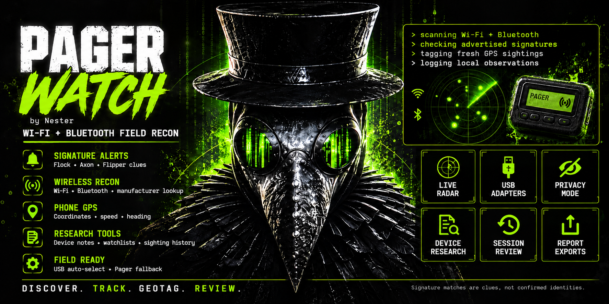

# PagerWatch

**Wi-Fi & Bluetooth reconnaissance for the WiFi Pineapple Pager · by Nester**

Discover nearby radios, inspect device signatures, track signals and save GPS-tagged sightings. Use the Pager's display in the field or open the dashboard on your phone or laptop.

[Install](#install) · [How to use](#how-to-use) · [Latest changes](RELEASE-NOTES.md) · [Credits](NOTICE.md)

## Features

- **Wi-Fi & Bluetooth discovery** — separate device lists, signal history and manufacturer lookup.
- **Device alerts** — Flock, Axon, Flipper Zero, tracker and other signature clues, with evidence for each match.
- **Radar & tracking** — live signal radar and channel hold for a selected Wi-Fi target.
- **USB adapters** — automatic USB selection and Pager fallback, with manual selection when needed.
- **Phone GPS** — coordinates, speed, heading and location tags for new sightings.
- **Device research** — notes, photos, labels, bookmarks, watchlists and past sightings.
- **Saved sessions** — review, compare and export findings as CSV, JSONL, GeoJSON or HTML reports.
- **Privacy mode** — hide names, addresses and location details on screen.
- **Field tools** — Survey, Track and Quiet profiles, known-gear filtering, radio health and storage status.
- **Recovery & backups** — interrupted-session checkpoints and settings backup/restore.

## Install

Download **PagerWatch-1.0.8-release.zip** from this repository's **Releases** and extract it. Copy the entire extracted `PagerWatch` folder to:

```text
/root/payloads/user/reconnaissance/
```

**Ubuntu:** connect your laptop to the Pager. Open a terminal in the folder containing the extracted `PagerWatch` directory and run:

```bash
scp -O -r PagerWatch root@172.16.52.1:/root/payloads/user/reconnaissance/
```

Enter your Pager's root password. Use its actual IP address if different. `-O` selects the older SCP protocol for Pager compatibility.

**Windows:** connect with WinSCP using SCP, port `22`, username `root` and your Pager password. Drag the full `PagerWatch` folder into the directory above.

On the Pager, launch **Payloads → User → Reconnaissance → PagerWatch**. Press **A** past the startup image. Startup checks attempt to install missing supported dependencies; the Pager needs internet access for package downloads. USB adapters need compatible drivers.

**Updating:** finish the running payload, replace matching release files and keep `config.json` and `.state`. Copy the complete release folder, then relaunch.

## How to use

1. **Start scanning.** Browse Wi-Fi, Bluetooth, radar and status on the Pager.
2. **Open the dashboard.** Connect your phone or laptop to Pager Wi-Fi. Open the HTTPS address shown on **WEB**—normally `https://172.16.52.1:8443`—and enter the displayed six-digit code.
3. **Share GPS.** Open **Phone GPS → Share this device's GPS**. Allow location and wait for a fresh fix. Keep the phone connected, awake and the page open.
4. **Inspect devices.** Open **Devices** to track a signal, add a label/bookmark or review research and past sightings.
5. **Save your results.** Use **Sessions** to review runs and **Controls & exports** to download reports, manage adapters or back up settings.

**Pager buttons:** Left/Right changes tabs; Up/Down selects or scrolls; **A** opens/applies; **B** goes back. Open **FIELD** for run summaries, GPS, known gear and saved runs. In device details, **A** opens actions.

## Good to know

- Signature matches are clues, not confirmed identities. Shared-prefix wildcard probes appear as **Possible Flock**; ordinary devices can also match. Detection depends on receiving a device's transmissions.
- GPS marks where the receiver heard a device, not the device's exact position. Phone browsers do not provide satellite counts.
- Privacy masks the screen. Exports, backups and API responses retain original data. No automatic uploads or online research lookups are performed.
- Leave adapter selection on **Auto** for USB-to-Pager fallback. A manually selected adapter stays pinned.

[Release notes](RELEASE-NOTES.md) · [Hardware test checklist](FIELD-TEST.txt) · [GPL-3.0-or-later](LICENSE)

---

Created by **Nester**, with development help from **ChatGPT**. Thanks to **RocketGod**, **Hackazillarex** and the contributors whose shared work helped make PagerWatch possible. See [credits and licenses](NOTICE.md).
